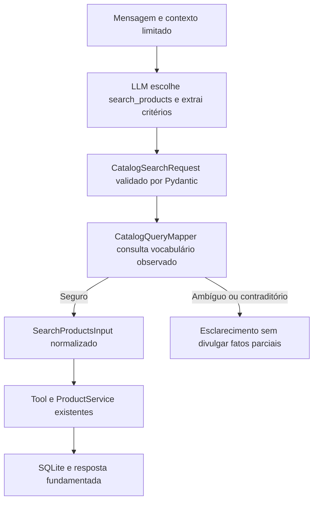

# Interpretação estruturada do catálogo

Implementada em 03/11/2026, por solicitação do usuário, limitada inicialmente ao
catálogo. Preserva as seis ferramentas, o provedor Qwen, recuperação documental,
sessões, autorização de pedidos e regras de preço/disponibilidade.

## Fluxo



O nome da função determina a intenção `search_products`. Os argumentos do LLM
separam `product.category`, `product.subtype`, marca/modelo em `product.name`,
`characteristics`, orçamento, disponibilidade e limite de itens. O backend
registra a intenção tipada e traduz esses critérios. Não foi criada uma função
fictícia para classificar intenções nem uma chamada extra obrigatória ao modelo.

Para o exemplo de ukulele soprano natural até R$ 250, a representação tipada é:

```json
{
  "intent": "search_products",
  "product": {"category": "ukulele", "subtype": "soprano", "name": null},
  "characteristics": {"cor": "natural"},
  "max_price": "250",
  "available_only": true
}
```

A consulta resolvida usa `category="Ukuleles"`, ID derivado do catálogo,
`term="soprano"`, `specs={"color":"natural"}` e teto Decimal de R$ 250.
Nenhum ID ou resultado esperado foi codificado na implementação.

## Validação e normalização

- Categorias e nomes de atributos vêm de `ProductService.catalog_facets()`, que
  lê somente dados de produtos/categorias. Não fornece preços em cache ou PII.
- Singular/plural e acentos permitem associar o tipo declarado à categoria
  observada. Uma categoria única explicitamente mencionada pelo cliente pode
  recuperar uma extração desconhecida. Categorias conhecidas incompatíveis
  exigem esclarecimento.
- `cor`, `cordas`, `captação` e outros aliases documentados são associados às
  chaves observadas. Sinônimos limitados e tipos numéricos só são normalizados
  quando têm correspondência na fonte. Características desconhecidas não são
  descartadas para produzir resultados.
- Uma entidade colocada em slot incorreto pode ser recuperada quando a fonte
  comprova uma correspondência única, por exemplo nylon como material de cordas.
  Um descritor de tipo/tamanho só vira filtro textual se estiver observado nos
  nomes, ou é redundante quando já consta do rótulo exato da categoria.
- Limites explícitos reconhecíveis de orçamento e valores observados de cor/cordas
  não podem desaparecer na extração. Conflitos pedem esclarecimento. Há limites
  de tamanho, tipos e campos; SQL, identidade, floats monetários e entradas
  contraditórias não são convertidos em consultas amplas.
- `name_terms` é uma extensão técnica limitada: marca e subtipo são aplicados
  por conjunção. A paginação guarda a consulta normalizada e consulta novamente
  o SQLite. Continuação não depende de nova inferência.

Os metadados `AgentResult.catalog_interpretations` contêm pedido tipado e consulta
resolvida para inspeção Python. São privados, excluídos de repr/serialização HTTP
e não são adicionados aos logs. A interpretação é local ao turno; o mapper não
guarda dados de conversas entre clientes. A API pública permanece com os mesmos
campos. Devoluções e pagamentos mantêm os fluxos anteriores; não foi adicionada
uma máquina de estados geral de atendimento.

## Compatibilidade do modelo e dos contratos

`agent_tool_contracts()` oferece a estrutura semântica somente em `search_products`.
O schema é explícito, com os objetos embutidos, sem referências `$ref` para essa
entrada. O campo de operação redundante não é solicitado ao modelo, para evitar
confusão com `intent` do plano final da resposta. As outras cinco tools não mudam.

Os primeiros testes reais detectaram argumentos planos e depois um objeto
`product` serializado como string JSON pelo Qwen. O formato plano foi recusado.
A fronteira agora aceita também um único nível de objeto JSON codificado como
string, com limite de 4.096 bytes, rejeição de duplicatas, NaN, listas e sintaxe
Python; depois aplica o mesmo modelo estrito. Isso normaliza o transporte sem
aceitar campos extras ou inventar critérios. Não usa `eval` ou `literal_eval`.

Callers legados de filtros técnicos passam por um adaptador explícito quando
usados na orquestração. A chamada direta ao registro mantém o contrato técnico
validado anterior, acrescido de `name_terms`. Nenhum contrato permite SQL livre.

## Verificações e avaliação real

Ollama local, `qwen3.5:9b`, contexto 4096, temperatura 0, thinking `none`,
finalização estruturada ativa. Sem novos modelos, dependências ou provedores externos.

O exemplo real retornou os três produtos esperados. O trace comprova o objeto
tipado e a consulta normalizada, com duas chamadas ao adaptador — a mesma contagem
do fluxo anterior para esse exemplo. Três controles definidos antes da execução
(teto menor, concert e violões de nylon) também retornaram os IDs esperados.
Na primeira rodada, o controle sem resultados pediu esclarecimento em vez de
informar ausência; sua conferência de IDs vazios não comprova qualidade da
resposta. Na versão final carregada na API, a mesma pergunta informou
corretamente que não encontrou produtos.

Após reiniciar o servidor local, três chamadas HTTP com inferência real
retornaram 200: a pergunta original trouxe IDs 118/116/117 (38.751,54 ms),
marca Kalani + soprano + natural + até R$ 250 trouxe somente 118 (6.984,87 ms),
e soprano natural até R$ 179 informou ausência (5.652,26 ms). Esses tempos incluem
todo o atendimento HTTP e não são comparados com o benchmark sintético. A API
não expôs a interpretação privada ou credenciais de sessão nos registros.

Os 40 cenários existentes foram executados com fixtures de catálogo/pedidos e PDF
inteiramente sintéticos. Os gabaritos de 40/18 casos foram preservados por SHA-256.
A linha de base carregou o orquestrador, prompt e contratos anteriores das cópias
preservadas, em processo separado, sem alterar o workspace ou reescrever histórico.

| Métrica observada | Antes preservado | Primeira versão | Versão consolidada |
|---|---:|---:|---:|
| Casos com sucesso | 37/40 | 34/40 | 39/40 |
| Turnos com sucesso | 43/46 | 39/46 | 45/46 |
| Seleção de ferramentas | 44/46 | 41/46 | 44/46 |
| Argumentos | 42/46 | 38/46 | 43/46 |
| Grounding aplicável | 26/26 | 24/24 | 28/28 |
| Compliance automático | 46/46 | 46/46 | 46/46 |

A primeira versão revelou slots trocados e descritores que já pertenciam à
categoria. A normalização foi corrigida por evidências do catálogo, com testes,
sem regras por IDs de cenário nem mudanças nos gabaritos. A versão consolidada
passou os oito casos de catálogo. O caso residual é POL08: o modelo respondeu
fora do escopo à pergunta de senha Wi-Fi; o gabarito esperava uma consulta a
políticas sem evidência. Isso não foi contado como sucesso, apesar de não divulgar
segredos ou fatos inventados. Outros turnos têm seleção/argumentos diferentes do
esperado, ainda que cumpram a tarefa; métricas são reportadas separadamente.

A mediana/p95 de todos os turnos foi 3.645,63/6.055,78 ms na linha de base e
3.716,48/6.067,41 ms na versão consolidada. Há turnos de guard sem inferência nesses
denominadores. Para seleção somente em turnos normais com inferência real, a
versão consolidada teve 34/36. Latência mediana/p95 do adaptador:
1.390,45/3.984,45 ms. A comparação temporal é descritiva: houve aquecimento/cache
e a linha de base coincidiu brevemente com um diagnóstico de dois casos; não
constitui benchmark isolado nem demonstra superioridade estatística.

Uso informado: 192.532 tokens conhecidos em 38 turnos na linha de base;
199.650 em 38 turnos na versão consolidada. Outros turnos não têm uso informado,
inclusive guards sem LLM. Não foi estimado custo monetário. Foram observadas
70 e 72 chamadas ao adaptador, respectivamente, não contagem garantida de
requisições HTTP internas da finalização estruturada.

```bash
.venv/bin/python -m pytest -q --tb=short
# 600 passed in 19.56s; nenhum skip
.venv/bin/ruff check .
# All checks passed!
.venv/bin/python -m compileall -q app
git diff --check
# Exit 0
```

São 39 testes novos de normalização, transporte, orçamento, conjunção, ambiguidades,
fontes sintéticas, isolamento e paginação. Testes offline não são apresentados
como inferência real. Os relatórios medidos e rejeições iniciais são preservados.

## Arquivos e limites

Novos: `app/schemas/catalog_request.py`, `app/tools/catalog_mapper.py`,
`app/agent/catalog_contracts.py`, dois arquivos `test_catalog_intent.py`,
`docs/agent_tool_contracts.json` e este relatório. Alterados: orquestrador/modelos
do agente, prompt, registro/schemas de tools, ProductService/modelos de busca,
README, decisões e documentação dos contratos. Nenhuma alteração em serviços
de preços, pedidos, autorização, SDK/provedor, UI ou configuração `.env`.

A extração do LLM continua falível. Normalização lexical, aliases e âncoras
explícitas não resolvem toda negação, comparação, disjunção ou vocabulário novo.
O vocabulário provém das categorias presentes em produtos; categorias vazias
podem exigir esclarecimento. Critérios sem correspondência segura não geram uma
consulta relaxada. A memória permanece limitada; apenas o catálogo foi estruturado
nesta etapa. Não há garantia de entendimento universal nem homologação comercial.

Dados brutos, banco e gabaritos permanecem imutáveis. O Git continua sem arquivos
rastreados; o diff vazio não representa a alteração. Cópias anteriores e relatórios
completos ficam em `data/derived/catalog_intent/`, ignorado. Não houve commit,
push ou publicação. [Evidência sanitizada](catalog_interpretation_validation.json).
